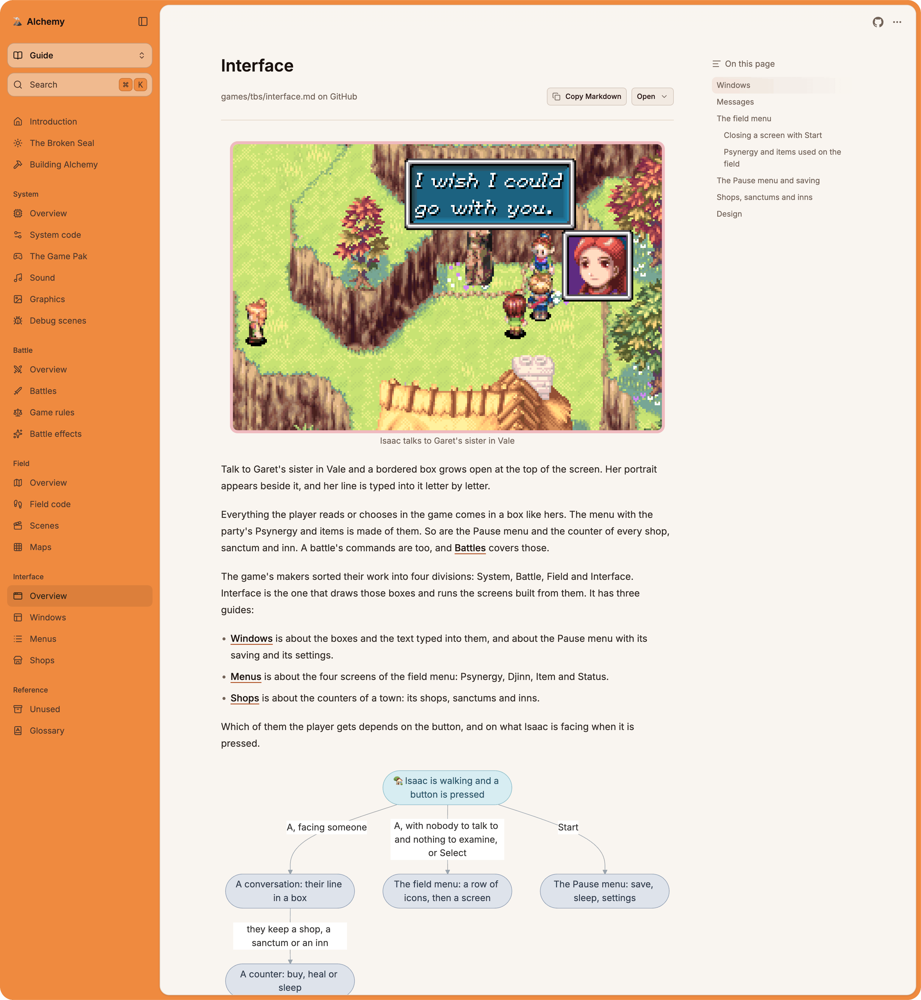

# 🌋 Alchemy Docs

The documentation site for [Alchemy](https://github.com/PascalPixel/alchemy), [alchemy.pascalpixel.com](https://alchemy.pascalpixel.com), built with [Fumadocs](https://fumadocs.dev) on [Next.js](https://nextjs.org). Its pages are written from Alchemy's own READMEs and the `///` comments in its C, and its recordings of the game are kept in a Vercel Blob store.



## Build

With [Bun](https://bun.sh), and Alchemy checked out beside this folder:

```bash
bun install
bun run build
```

The site is in `out`, and `bun run dev` serves it while you edit. To read an Alchemy somewhere else, set `ALCHEMY=/path/to/alchemy`. Vercel builds and publishes the site on every push here, and once a day, at midnight UTC, when Alchemy's main branch changed that day.

The app is Fumadocs' Next.js template (`create-fumadocs-app`, static export) with the site's colours, logo, robots and sitemap; the docs are at the site's root rather than under `/docs`. The generator writes the sidebar's tabs and order as `meta.json` files.

To build on a machine of 4 cores and 8 GB, three things differ from the template: each page is compiled when it is written (`source.config.ts`, `patches/`, four workers with a 512 MB heap in `next.config.mjs`), the sidebar is written once before the build (`scripts/sidebar.ts`) rather than into every page, and the search loads one file of the pages' text (`src/app/search.json`) rather than an index.

## Credits

The site documents Alchemy, whose [acknowledgements](https://github.com/PascalPixel/alchemy#acknowledgements) name the work it builds on.
